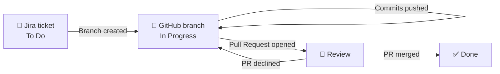

<div align="center">

# 🚀 Jira Workshop
### *From ticket to "Done" without touching the status dropdown*

**Jira tracks the work. GitHub builds the thing. Automation keeps them honest.**

[🌐 Live site](https://noble-finances-phi.vercel.app) · [📋 Jira board](https://obetoxteam.atlassian.net/jira/software/projects/NF/boards/4/backlog?epics=visible) · [🎨 Figma](https://www.figma.com/site/dmVOrA4xnakj1S2NPZensu/Friendly-Accounting-Services--Community---Copy-?node-id=0-1&p=f&t=HlB3rAdBCG1f2lay-0) · [📦 Starter assets](https://github.com/0xm3d/Jira-Workshop-Assets)

</div>

---

## 🎬 The Problem

Picture a team of three, a landing page to build, and one question nobody can answer fast:

> *"Wait... who is working on what?"* 🤔

Tasks were tracked badly, statuses drifted out of sync with the code, and "I thought you finished that" became a daily sentence.

## 🎯 The Mission

Build a workflow where **GitHub activity moves Jira tickets by itself**. Nobody drags cards. Nobody forgets to update a status. The board tells the truth.

---

## 🗺️ The Journey of a Ticket

```text
   🎫 Ticket        🌿 Branch         🔀 Pull Request       👀 Review          ✅ Done
  ──────────►  ──────────────►  ───────────────────►  ──────────────►  ──────────►
   Created in      One branch        Opened and            A teammate        Merged,
   Jira and        per task,         linked to the         checks the        ticket
   assigned        ticket key        ticket                code              closes itself
                   in the name
```



---

## 🧰 The Toolbox

| Tool | Role in the team | Link |
| --- | --- | --- |
| 📋 **Jira** (project `NF`) | Plans the work: epics, stories, sprints, board | [Open board](https://obetoxteam.atlassian.net/jira/software/projects/NF/boards/4/backlog?epics=visible) |
| 🐙 **GitHub** | Holds the code, branches and Pull Requests | [Jira-Workshop](https://github.com/ahtalbi/Jira-Workshop) |
| 📦 **Starter assets** | The base files the project started from | [Jira-Workshop-Assets](https://github.com/0xm3d/Jira-Workshop-Assets) |
| 🎨 **Figma** | The design: *Friendly Accounting Services* | [Open design](https://www.figma.com/site/dmVOrA4xnakj1S2NPZensu/Friendly-Accounting-Services--Community---Copy-?node-id=0-1&p=f&t=HlB3rAdBCG1f2lay-0) |
| ⚙️ **Jira Automation** | The glue: GitHub events move the tickets | Configured in the Jira project |
| 🌐 **Vercel** | Hosts the deployed site | [noble-finances-phi.vercel.app](https://noble-finances-phi.vercel.app) |

> 🔒 The Jira board is private. You need access to the Atlassian workspace to see it.

---

## 👥 The Crew

Three people, one board, zero confusion. The Scrum Master split the work, and each member owns different sections of the page.

| | Member | Role | Owns |
| --- | --- | --- | --- |
| 🧭 | Ahmed Talbi | Scrum Master | _Fill in_ |
| 🛠️ | Mohamed Bouhadi | Developer | _Fill in_ |
| 🛠️ | Baha-eddine Aboul Ouafa | Developer | _Fill in_ |

---

## 🏗️ Setting the Stage

### 1️⃣ The Jira board

A **Scrum** project with four columns:

```text
 ┌──────────┐   ┌─────────────┐   ┌──────────┐   ┌────────┐
 │  To Do   │ → │ In Progress │ → │  Review  │ → │  Done  │
 └──────────┘   └─────────────┘   └──────────┘   └────────┘
```

Epics split the landing page into sections, stories and tasks go to individual members, and sprints keep the pace.

### 2️⃣ Wiring Jira to GitHub

- 🎫 Every ticket is created and assigned in Jira.
- 🌿 Every task gets its own GitHub branch.
- 🔗 Branches and Pull Requests are linked to their tickets.
- 🏷️ The ticket key shows up in branches, commits and PR titles, which is how Jira knows what belongs where.

---

## ⚡ The Automation Magic

GitHub does something, Jira reacts. Here is the rulebook:

| 🎬 GitHub event | 🪄 What Jira does |
| --- | --- |
| 🌿 Branch created | _Fill in (for example: `To Do` → `In Progress`)_ |
| ⬆️ Commit pushed | _Fill in_ |
| 🔀 Pull Request opened | _Fill in (the brief suggests `Review`)_ |
| ✅ Pull Request merged | Ticket moves to `Done` |
| ❌ Pull Request declined | _Fill in (for example: back to `In Progress`)_ |

> 🎯 **Workshop target:** at least **2 automations**, both tested. This team went further and tracks branch creation, pushes, merges and declines.

---

## 📁 What's in the Box

```text
Jira-Workshop/
├── 🖼️  assets/       images and static files
├── 📄  index.html    the landing page
└── 🎨  styles.css    the styling
```

The layout mirrors the [starter assets repo](https://github.com/0xm3d/Jira-Workshop-Assets), where the stylesheet is named `style.css`.

---

## 📜 House Rules

### 🌿 Branch names: start with the ticket key

```text
NF-12-header-section
NF-15-pricing-cards
```

### 💬 Commits: ticket key first

```text
NF-12 Add header navigation
NF-12 Fix mobile menu spacing
```

### 🔀 Pull Requests

- 🏷️ Put the ticket key in the title: `NF-12 Header section`
- 🔗 Link the PR to the Jira ticket
- 👀 Get a teammate to review before merging
- ✅ Merge into `main` only after review

---

## 🏆 Proof of Work

Everything the workshop asks us to show:

- [ ] 📸 A capture or demo of the **Jira board**
- [ ] 🔀 **Pull Requests** linked to Jira tickets
- [ ] ⚙️ The configured **automation rules**
- [ ] 🎥 A ticket whose **status changes by itself** after a GitHub action

---

## 🎤 Demo Script

| Step | Action | What the audience sees |
| --- | --- | --- |
| 1 | Open the Jira board | Assigned tickets, one per member |
| 2 | Create a branch from a ticket | Ticket jumps to `In Progress` 🌿 |
| 3 | Push a commit | Commit appears on the ticket ⬆️ |
| 4 | Open a Pull Request | Ticket slides into `Review` 👀 |
| 5 | Merge the Pull Request | Ticket lands in `Done` ✅ |
| 6 | Decline another PR | Ticket reacts to the rejection ❌ |
| 7 | Open the automation audit log | Every rule that fired, with timestamps ⚙️ |

---

<div align="center">

### 💡 The whole idea in one line

**Jira to follow the work → GitHub to build it → Automation to keep them in sync.** 🚀

*Built by a team of three, for a workshop on making tools talk to each other.*

</div>